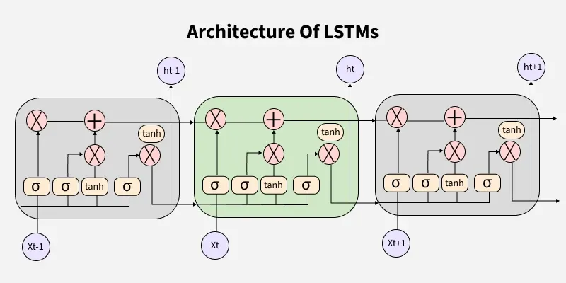

## Next word prediction using LSTM

### Initiate the notebook
* Clone the repository: 
`git clone https://github.com/sudiptoshahin/next-word-prediction-lstm.git`

* Create python environment:
`python3 -m venv env`

* Activate environment:
`source env/bin/activate`

* Install all packages/libraries:
`pip install -r requirements.txt`


## Model is based on LSTM

__Long-Short-Term-Memory(LSTM) which is a special type Recurrent Neural Network(RNN) and the RNN is a special type Deep Neural Network which is specially design to handle the sequential data like text, signals, audios etc__


### Description
Here i've use a synthetic data which is generated claude. In this document(dataset) i've total `59993` characters and total `10134` tokens. With these tokens i've built a vocabulary of `2776` tokens.

I've use some preprocessing technique like text to indices, then convert them to numerical sentences, then add the padding and prepare the training sequences with the same length and pass it on the model.

```
LSTMModel(
  (embedding): Embedding(2776, 64)
  (lstm): LSTM(64, 128, batch_first=True)
  (fc): Linear(in_features=128, out_features=2776, bias=True)
)
```

And using `50` epochs, learning rate `0.001`, loss is `CrossEntropyLoss` and using the `Adam` optimizer for training. From total `9911` data i've split its `0.2%` of data for testing and achive `99.0%` accuracy for both training and testing. It needs some more evaluation and debugging and testing and also training so it will continue.